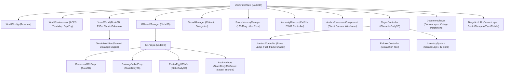

# HOLLOW CORE — MILESTONE 1 (M1) SCENE ARCHITECTURE
**Senior Godot Systems Architect & Technical Director**  
**Godot Engine 4.7+ Forward+ (Vulkan 1.4, Windows 64-bit)**  
**Version:** 1.0  

---

## 1. COMPONENT SCENE TREE HIERARCHY

The playable Vertical Slice is hosted in `scenes/development/m1_vertical_slice.tscn`, driven by `scripts/world/m1_vertical_slice.gd`.



---

## 2. MODULAR SCRIPTS & RESPONSIBILITIES

| Script File | Class Name | Architectural Responsibility |
| :--- | :--- | :--- |
| `scripts/world/m1_vertical_slice.gd` | *Root Controller* | Coordinates sub-systems, wires player signals, handles F5/F9 persistence. |
| `scripts/world/m1_level_manager.gd` | `M1LevelManager` | Sculpting geometry across Zones A, B, C, D, E and instantiating interactive props. |
| `scripts/gameplay/rock_anchor.gd` | `RockAnchor` | Placed wall anchor with forged eyelet and 3.5m climbing rope. |
| `scripts/gameplay/anchor_placement.gd` | `AnchorPlacementComponent` | Real-time amber wireframe projection, rock normal alignment, placement validation. |
| `scripts/narrative/document_d01.gd` | `DocumentD01Prop` | Dispatch box in Airlock 4 holding 1894 Prokhorov shift log. |
| `scripts/narrative/document_viewer.gd` | `DocumentViewer` | Fullscreen diegetic weathered parchment document inspection overlay. |
| `scripts/narrative/easter_egg_06.gd` | `EasterEgg06Safe` | Vault safe with combination code 1-9-2-4 and Watcher manifestation trigger. |
| `scripts/world/drainage_valve.gd` | `DrainageValveProp` | Cast-iron gate valve wheel controlling lower sump water drainage. |
| `scripts/horror/anomaly_director.gd` | `AnomalyDirector` | Pacing and timing for EV-01 (Delayed Steps) and EV-02 (Fourth Strike). |
| `scripts/lantern.gd` | `Lantern` | Physical brass lantern with fuel burn, analog needle gauge, and camera sway. |
| `scripts/player_controller.gd` | `PlayerController` | FPS exploration controller with Area3D raycast pickup fix, mining, and vitals. |

---

## 3. SIGNAL BUS COMMUNICATION MATRIX

```
+---------------------------------------------------------------------------------------+
| SOURCE SCRIPT          | SIGNAL                     | TARGET SCRIPT & ACTION          |
+------------------------+----------------------------+---------------------------------+
| PlayerController       | acoustic_noise_emitted     | SoundMemoryManager.record_event |
| PlayerController       | acoustic_noise_emitted     | AnomalyDirector.check_ev02_hits |
| DrainageValveProp      | valve_turned               | M1VerticalSlice._on_valve_opened|
| DocumentD01Prop        | document_read_event        | DocumentViewer.show_document    |
| EasterEgg06Safe        | safe_opened                | Lantern.flicker(3.2)            |
| EasterEgg06Safe        | watcher_manifested         | SoundManager.play_sfx           |
| AnomalyDirector        | anomaly_triggered          | SoundManager.play_sfx           |
| AnchorPlacement        | anchor_placed              | M1Props.add_child(RockAnchor)   |
| Lantern                | fuel_changed               | DiegeticHUD.update_fuel_display |
+---------------------------------------------------------------------------------------+
```
